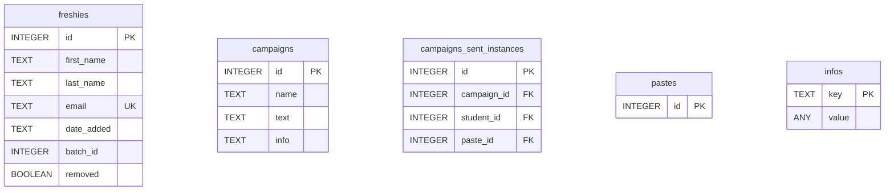

# 01 — Current state (Textual TUI)

The current application is a local Textual app backed by a SQLite file in the process
working directory. It has roughly 1,000 lines of Python in `src/`. This document records
what exists so the rewrite has a feature-parity contract, and which behaviours must not
be copied unchanged.

## Feature inventory

| Screen | Current behaviour | Source | Rewrite requirement |
| --- | --- | --- | --- |
| Home | Welcome text, count of freshies, random fact on tab activation | `app.py`, `home.py` | Dashboard with real counts/status; trivia is optional and can be a dashboard widget |
| Freshies | Read-only table of all people: first name, last name, email, date added; sorted by last name | `freshies_view.py` | Searchable/sortable/paginated table, filters, row detail, edit/remove, manual add |
| Campaigns | Tab per campaign; side-by-side "sent to" and "not sent to" tables; create campaign (name + notes); "copy all" moves every unsent person into a new send batch and copies their emails | `campaigns_view.py` | Campaign list + detail, create/edit/archive, audience preview, explicit "prepare send" with confirmation and undo |
| Copies | Every past send batch, grouped and collapsible, with global fuzzy search and per-batch search | `sends_view.py` | Send-history screen with search, filters, batch detail, re-copy, recipient snapshots |
| Adds | People grouped by import batch, newest first | `adds_view.py` | Import-history screen: batches, source file, counts, preview/review, per-batch member list |
| Help (`?`) | Static Markdown manual | `home.py` | In-app help and keyboard-shortcut reference |
| Import | File picker for `.xlsx`, fixed header/footer and fixed `VORNAME`/`NACHNAME`/`EMAIL` columns; adds unseen emails to a new batch | `load.py`, `db.py` | Import wizard: file → column mapping → diff preview → resolve conflicts → apply; CSV also supported |
| Theme | Toggle dark/light | `app.py` | System/light/dark theme with persisted preference |
| Clipboard | `pyperclip.copy` after "copy all"; row click only shows a notification | `campaigns_view.py` | Real clipboard integration with success/failure feedback and re-copy |

## Schema currently in use

`src/db.py` creates these tables on every connection (`CREATE TABLE IF NOT EXISTS`):

- `pastes` has no columns besides `id`; it is used only as a batch identifier.
- `infos` is created but never used by the current code.
- `freshies.removed` exists but no current flow sets it.
- Foreign keys are declared but SQLite does not enforce them unless
  `PRAGMA foreign_keys = ON` is set, which the app never does.
- `campaigns_sent_instances` is the only send-history record. It joins live
  `freshies` rows to recover the address, so history follows edits.
- There are no schema migrations. The schema is re-created if absent.

## Behaviours worth preserving

- **Batches:** each import creates a new batch id (`MAX(batch_id) + 1`), and the Adds
  screen groups by it.
- **Send batches:** each copy-all operation gets a new paste/batch id, so one campaign
  can have several copies. Copies can be searched globally and per batch.
- **Sent/not-sent semantics:** a person is "not sent" for a campaign until a send record
  exists for that campaign, independent of other campaigns.
- **Fuzzy search:** the current copy search accepts substrings and one-edit-away matches
  for terms of four or more characters. The rewrite should use a documented fuzzy
  matcher (for example `fuse.js` on the frontend for loaded pages, or SQL `LIKE`/FTS5
  for whole-database search).
- **Keyboard-first use:** the TUI is fast to operate. The GUI should keep a command
  palette and shortcuts for import, search, new campaign, prepare send and navigation.

## Defects and limitations the rewrite should fix

1. **Identity is email-only.** `UNIQUE(email)` plus `INSERT OR IGNORE` means a changed
   email creates a second person and the old one lingers. This is the open roadmap item.
2. **Removals are invisible.** Someone removed from the source sheet stays active and
   keeps receiving mail.
3. **Send history is not immutable.** Joining `freshies` means editing or deleting a
   person changes or erases what a past batch reports.
4. **No import validation or preview.** Fixed row/column assumptions break on real
   spreadsheets; failures happen after data is written.
5. **Campaign deletion is a debug hammer.** `DEBUG_clear_table("campaigns")` deletes
   campaigns without touching send instances, leaving orphans; there is no confirmation.
6. **Copy-all has no real row-copy.** Row selection only notifies; it never writes to the
   clipboard.
7. **DB path depends on the working directory.** Launching from another directory
   creates/uses a different database.
8. **No backups, no transactions across multi-step flows, no tests.**
9. **Broken work-in-progress file.** `src/conflict_resolution.py` is untracked and does
   not parse (unterminated dataclass, undefined names). It is a sketch of the intended
   conflict feature, not a usable module.
10. **UI state is global reactive state.** Views watch the whole dataset and recompose;
    the rewrite should use query keys and targeted invalidation instead.

## Feature-parity definition

The rewrite reaches parity when a user can, without the TUI:

- import an `.xlsx` (and ideally CSV) list with a preview and receive a per-row outcome;
- see all contacts, search/filter/sort them, and add or edit one manually;
- create, rename, archive and inspect campaigns;
- see exactly who has and has not received a campaign;
- prepare a send batch, copy all recipient emails in one action, and see the new batch
  in send history;
- re-copy any past batch and search history;
- see import batches and their members;
- open the database from a stable app-data location and recover from a pre-migration
  backup.

Conflict resolution and manual additions are roadmap items, but the schema and import
pipeline are designed for them from day one so they are additions rather than rewrites.
