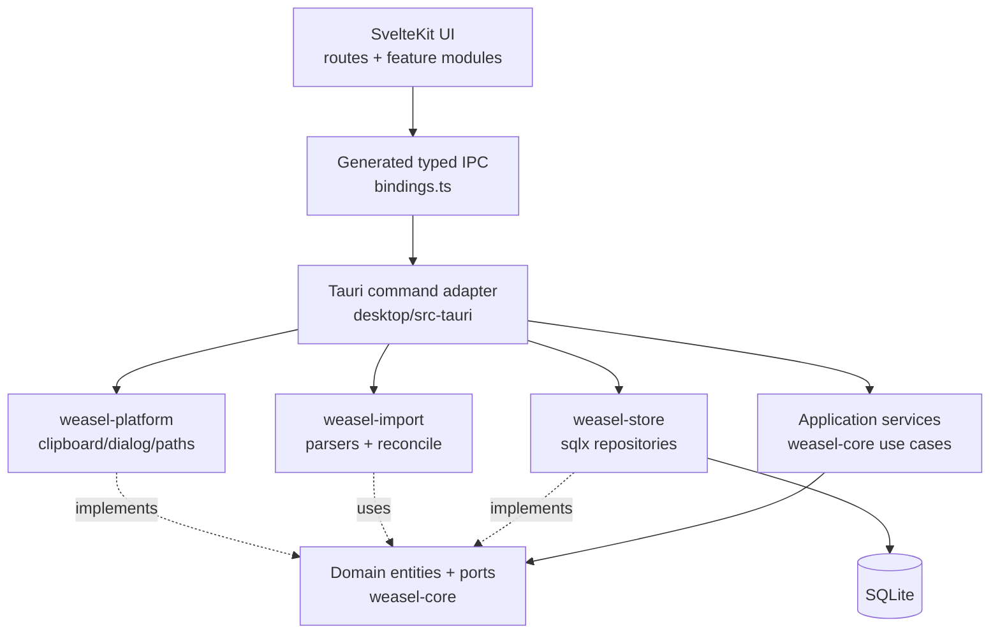
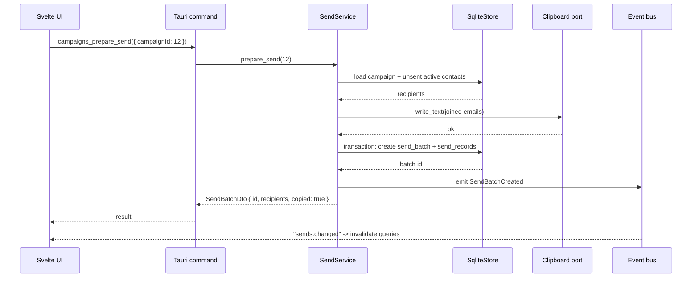

# 02 — Target architecture

## Goals

1. Reproduce the TUI's workflows in a desktop GUI without regressions.
2. Make new features additive: a new screen or capability should be a module, not a
   change spread across five existing files.
3. Keep all data local and recoverable.
4. Keep the domain testable without a window, a database file, or a Tauri runtime.
5. Make the IPC boundary typed and versioned so frontend and backend cannot drift
   silently.

## Stack

| Concern | Choice | Why |
| --- | --- | --- |
| Desktop shell | Tauri 2 | Small bundles, native dialogs/clipboard/updater, Rust backend |
| UI | SvelteKit + Svelte 5 + TypeScript | File-based routing, small runtime, runes, great table/form ergonomics |
| Static serving | `@sveltejs/adapter-static` with SPA fallback | Tauri serves bundled files; no Node server at runtime |
| Styling | Tailwind CSS + shadcn-svelte-style primitives | Accessible, themeable, copy-in components rather than a locked-in kit |
| Server state | TanStack Query (Svelte adapter) | Caching, retries, invalidation by query key |
| Tables | TanStack Table (Svelte adapter) + virtualizer | Sorting/filtering/selection without hand-rolling |
| Forms | SvelteKit `superforms` + `zod` (or native Svelte 5 forms) | Validation shared between UI and command payloads |
| Backend | Rust 2024 edition, stable toolchain | One binary, strong types, no runtime dependency |
| DB | SQLite via `sqlx` (WAL) | Same data model, async pool, embedded migrations |
| DB migrations | `sqlx::migrate!` with forward-only SQL files | Auditable, testable, embedded in the binary |
| Spreadsheet parsing | `calamine` (xlsx/xls/ods) + `csv` | Pure Rust, no Python/Pandas |
| IPC types | `specta` + `tauri-specta` v2 | Generates TypeScript bindings from Rust in CI |
| Clipboard | `arboard` behind a port, or `tauri-plugin-clipboard-manager` | Swappable and testable |
| Dialogs | `tauri-plugin-dialog` behind a port | Native file/folder pickers |
| Logging | `tracing` + `tauri-plugin-log` | Structured logs to file for support |
| Settings | Backend `settings` table via `settings_*` commands | One source of truth, included in backups, exposed to feature flags |
| Updates | `tauri-plugin-updater` + signed artifacts | Ship fixes without reinstall |
| Package manager | `pnpm` | Fast, lockfile committed |

### Why not the alternatives

- **Electron:** much larger bundles and an extra Node runtime for little benefit here.
- **Web app:** the app needs local file access, a local database and clipboard access;
  a browser cannot provide the same dependable workflow.
- **Python sidecar with Tauri:** keeps Pandas, but adds process supervision, packaging
  and version-skew problems. `calamine` handles the actual spreadsheet needs.
- **`tauri-plugin-sql` from the frontend:** would put SQL and business rules in the UI.
  The backend owns the database; the frontend only sees typed commands.

## Repository layout

The current Python app moves to `legacy/python-tui/` so the rewrite has a clean root and
the old behaviour remains available as a reference until parity is accepted.

```text
weasel/
├── Cargo.toml                     # Rust workspace
├── rust-toolchain.toml
├── pnpm-workspace.yaml
├── crates/
│   ├── weasel-core/               # pure domain: entities, values, ports, errors
│   │   └── src/
│   │       ├── lib.rs
│   │       ├── contact.rs
│   │       ├── campaign.rs
│   │       ├── send.rs
│   │       ├── import.rs
│   │       ├── query.rs
│   │       ├── ports.rs
│   │       └── error.rs
│   ├── weasel-store/              # sqlx repositories + migrations + audit
│   │   └── src/
│   │       ├── lib.rs
│   │       ├── pool.rs
│   │       ├── mappers.rs
│   │       ├── contacts.rs
│   │       ├── campaigns.rs
│   │       ├── sends.rs
│   │       ├── imports.rs
│   │       ├── settings.rs
│   │       ├── audit.rs
│   │       └── legacy_import.rs
│   ├── weasel-import/             # parsing, column mapping, reconciliation
│   │   └── src/
│   │       ├── lib.rs
│   │       ├── source.rs
│   │       ├── mapping.rs
│   │       ├── reconcile.rs
│   │       ├── plan.rs
│   │       └── parsers/{xlsx.rs,csv.rs}
│   ├── weasel-platform/           # OS ports: clipboard, dialogs, paths
│   │   └── src/{lib.rs,clipboard.rs,dialogs.rs,paths.rs}
│   └── weasel-testkit/            # fixtures, in-memory DB, fake ports
├── migrations/                    # sqlx forward-only migrations
│   ├── 0001_initial.sql
│   └── 0002_...
├── desktop/
│   ├── package.json
│   ├── pnpm-lock.yaml
│   ├── svelte.config.js
│   ├── vite.config.ts
│   ├── src/
│   │   ├── app.html
│   │   ├── app.css
│   │   ├── routes/
│   │   │   ├── +layout.svelte
│   │   │   ├── +layout.ts
│   │   │   ├── +page.svelte                  # dashboard
│   │   │   ├── freshies/+page.svelte
│   │   │   ├── campaigns/+page.svelte
│   │   │   ├── campaigns/[id]/+page.svelte
│   │   │   ├── history/+page.svelte
│   │   │   ├── imports/+page.svelte
│   │   │   ├── imports/[id]/+page.svelte
│   │   │   ├── settings/+page.svelte
│   │   │   └── help/+page.svelte
│   │   └── lib/
│   │       ├── ipc/
│   │       │   ├── bindings.ts               # generated, committed
│   │       │   ├── client.ts                 # invoke wrapper + error mapping
│   │       │   ├── queries.ts                # query keys + query functions
│   │       │   └── events.ts                 # event names + invalidation map
│   │       ├── features/
│   │       │   ├── types.ts
│   │       │   ├── registry.ts
│   │       │   ├── dashboard/manifest.ts
│   │       │   ├── contacts/{manifest.ts,components/...}
│   │       │   ├── campaigns/{manifest.ts,components/...}
│   │       │   ├── sends/{manifest.ts,components/...}
│   │       │   ├── imports/{manifest.ts,components/...}
│   │       │   └── settings/manifest.ts
│   │       ├── shell/
│   │       │   ├── AppShell.svelte
│   │       │   ├── Sidebar.svelte
│   │       │   ├── Topbar.svelte
│   │       │   ├── CommandPalette.svelte
│   │       │   └── Toasts.svelte
│   │       ├── components/ui/                # button, dialog, data-table, field...
│   │       ├── stores/{settings.svelte.ts,theme.svelte.ts,toasts.svelte.ts}
│   │       └── utils/{format.ts,email.ts,fuzzy.ts,shortcuts.ts}
│   ├── tests/                                # Playwright / Vitest
│   └── src-tauri/
│       ├── Cargo.toml
│       ├── tauri.conf.json
│       ├── capabilities/default.json
│       ├── icons/
│       └── src/
│           ├── main.rs
│           ├── lib.rs                        # builder, plugins, state
│           ├── state.rs                      # AppState: services + pool + bus
│           ├── error.rs                      # AppError -> serializable DTO
│           ├── events.rs                     # emit domain events
│           ├── bindings.rs                   # specta export (test/build)
│           └── commands/
│               ├── mod.rs                    # collect_commands![...]
│               ├── app.rs
│               ├── contacts.rs
│               ├── campaigns.rs
│               ├── sends.rs
│               ├── imports.rs
│               └── settings.rs
├── legacy/python-tui/             # moved current app, read-only reference
├── docs/
│   ├── adr/                       # one file per irreversible decision
│   └── rewrite/                   # this plan
└── tools/
    └── gen-feature.mjs            # scaffolds a feature module end to end
```

Keeping `desktop/` separate means a future CLI, web dashboard or mobile client can reuse
`weasel-core`/`weasel-store` without dragging Svelte along.

## Layering and dependency rule



Hard rules:

- `weasel-core` imports no Tauri, no `sqlx`, no `calamine`, no Svelte.
- Commands are thin: validate payload, call one application service, map the result to a
  DTO, emit events. No SQL and no business rules in `commands/`.
- Repositories and OS capabilities are traits (ports) in `weasel-core::ports`. Adapters
  live in `weasel-store` and `weasel-platform`.
- The frontend never talks to SQLite and never constructs SQL.
- Every mutation goes through exactly one command. There is no "generic update" escape
  hatch.

## Runtime composition

`desktop/src-tauri/src/lib.rs` builds the app in this order:

1. Resolve `app_data_dir()`; create it if needed.
2. Open/copy/backup the database, run migrations, enable `foreign_keys`, WAL and a busy
   timeout.
3. Construct `SqliteStore`, `ImportService`, `TauriClipboard`, `TauriDialogs`.
4. Construct `AppState { pool, services, revision: AtomicU64 }`.
5. Register `collect_commands![...]`, plugins and the frontend.
6. Spawn no background workers in v1. Import runs as an async command with progress
   events; CPU-heavy parsing uses `spawn_blocking`.

The database path is `<app_data_dir>/weasel.sqlite3` (overridable in settings for an
advanced/portable setup). This removes the TUI's working-directory dependency.

## Request flow

Example: "prepare a send for campaign 12".



The clipboard write happens before the transaction commits. If the clipboard fails, no
batch is recorded. If the commit fails after copying, the command reports a retryable
error and the batch is absent; a retry reproduces the same recipient set because unsent
is derived from committed records. This is deliberately explicit rather than pretending
that OS clipboard and SQLite can share a transaction.

## Frontend architecture

- **Shell:** persistent sidebar, top bar, command palette (`Cmd/Ctrl+K`), toast region,
  error boundary and a global progress indicator for imports.
- **Routing:** SvelteKit routes for real screens. A route is a thin composition of
  feature components; data access lives in feature query modules.
- **Feature registry:** composes navigation, command-palette entries, dashboard widgets
  and settings sections from manifests. See [05-extensibility.md](05-extensibility.md).
- **Queries:** TanStack Query keyed by domain (`['contacts', filters]`,
  `['campaigns']`, `['campaigns', id, 'audience']`, `['send-batches']`,
  `['imports']`). Mutations invalidate precise keys; a global event listener maps
  backend events to the same invalidation map so multiple windows/actions stay fresh.
- **Tables:** server-side pagination and sorting; selection state is local to the table.
  Large recipient lists are virtualized.
- **Forms:** validation before invoke plus server-side validation; errors are mapped to
  fields by `details.field`.
- **Theme:** `system | light | dark`, persisted, applied before first paint to avoid a
  flash.
- **Accessibility:** keyboard reachable dialogs, focus trapping, labelled controls,
  visible focus, `prefers-reduced-motion` respected.

## Security and platform posture

- Tauri capabilities are least privilege: dialog, clipboard, opener and updater only.
  No shell/process capability, no arbitrary filesystem access from the frontend.
- CSP is locked to bundled assets; the app loads no remote code. External links open in
  the system browser through the opener plugin.
- Import paths come from the native dialog; the backend re-validates extension and
  canonicalizes the path.
- All SQL uses bound parameters. Dynamic sort/filter fields map through allowlists.
- Logs redact email addresses by default (configurable diagnostic mode).
- The database is backed up before every migration and before a legacy import. Backup
  creation is also exposed as a manual command.

## Performance budgets

- Cold start to interactive shell: < 2 s on a mid-range laptop.
- Contact list page: 100 rows per request, p95 < 100 ms for 50k contacts with indexes.
- Import preview of 10k rows: < 5 s, streamed progress, no UI freeze.
- No full-table load into the frontend; everything is paginated or aggregated.

## Non-goals for v1

- Sending email directly (SMTP/provider integration) — the current workflow is
  "copy addresses into a mail client". The architecture leaves an `EmailProvider` port
  and a future `sending` feature module for this.
- Multi-user sync, accounts, or a server.
- Rich campaign body editing beyond the existing name/notes/text fields.
- Plugin sandboxing. Extension points are in-process modules first; a WASM/plugin host is
  a later option.
