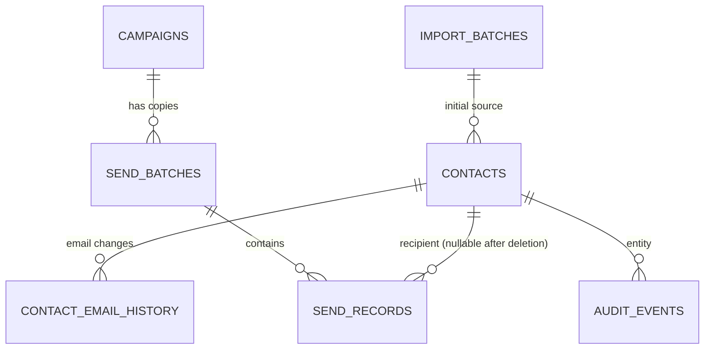

# 03 — Data model

SQLite stays. The rewrite replaces the implicit, email-keyed model with explicit
contacts, import batches, immutable send records, and an audit trail. Migrations are
forward-only SQL files in `migrations/`, embedded with `sqlx::migrate!`.

## Conventions

- **Timestamps:** `INTEGER` Unix milliseconds in UTC. Format for display in the UI;
  never store local-time strings.
- **IDs:** `INTEGER PRIMARY KEY` (SQLite rowid) for domain rows. UUIDs are only used for
  transient jobs such as an in-flight import.
- **Money/numbers:** integers or `REAL` as appropriate; not relevant yet.
- **JSON:** `TEXT` with `CHECK (json_valid(...))`, used only for genuinely extensible
  metadata, not as a substitute for modelled columns.
- **Soft deletion:** contacts use `status`; campaigns use `status`; send records and
  audit events are append-only. There is no cascade delete of history.
- **Email normalization:** trim whitespace and lowercase the whole address for matching
  and uniqueness. The original spelling is preserved in `contacts.email`. This is a
  pragmatic choice for a university mailing list; it is documented because local-part
  case is technically significant.
- **Optimistic concurrency:** editable rows carry `version`; updates include the version
  the client read and fail with `CONFLICT` if it changed.

## Entity relationship diagram



## Initial schema (`migrations/0001_initial.sql`)

```sql
-- One row per import/reconciliation run. Draft rows hold preview plans; applied rows
-- are the permanent record of what changed. Defined first because contacts reference it.
CREATE TABLE import_batches (
    id             INTEGER PRIMARY KEY,
    source_kind    TEXT    NOT NULL
                   CHECK (source_kind IN ('xlsx', 'xls', 'ods', 'csv', 'legacy', 'manual')),
    source_name    TEXT    NOT NULL,
    source_path    TEXT,
    file_hash      TEXT,
    scope          TEXT    NOT NULL DEFAULT 'roster'
                   CHECK (scope IN ('roster', 'delta')),
    status         TEXT    NOT NULL DEFAULT 'draft'
                   CHECK (status IN ('draft', 'applied', 'failed', 'discarded')),
    created_at     INTEGER NOT NULL,
    applied_at     INTEGER,
    row_count      INTEGER NOT NULL DEFAULT 0,
    added_count    INTEGER NOT NULL DEFAULT 0,
    updated_count  INTEGER NOT NULL DEFAULT 0,
    removed_count  INTEGER NOT NULL DEFAULT 0,
    conflict_count INTEGER NOT NULL DEFAULT 0,
    unchanged_count INTEGER NOT NULL DEFAULT 0,
    plan_json      TEXT CHECK (plan_json IS NULL OR json_valid(plan_json)),
    error          TEXT
);
CREATE INDEX ix_import_batches_created
    ON import_batches(created_at DESC);
CREATE INDEX ix_import_batches_status
    ON import_batches(status);

-- Contacts: the domain entity behind the "Freshies" screens.
CREATE TABLE contacts (
    id                INTEGER PRIMARY KEY,
    first_name        TEXT    NOT NULL,
    last_name         TEXT    NOT NULL,
    email             TEXT    NOT NULL,
    email_normalized  TEXT    NOT NULL,
    identity_key      TEXT,
    status            TEXT    NOT NULL DEFAULT 'active'
                      CHECK (status IN ('active', 'removed', 'archived')),
    source            TEXT    NOT NULL DEFAULT 'import'
                      CHECK (source IN ('import', 'manual', 'api')),
    import_batch_id   INTEGER REFERENCES import_batches(id) ON DELETE SET NULL,
    date_added        INTEGER NOT NULL,
    updated_at        INTEGER NOT NULL,
    version           INTEGER NOT NULL DEFAULT 1,
    notes             TEXT    NOT NULL DEFAULT '',
    metadata_json     TEXT    NOT NULL DEFAULT '{}'
                      CHECK (json_valid(metadata_json))
);

-- One live address per contact. Removed people keep their address so they can be
-- restored; archived people are out of the way and do not block a new person.
CREATE UNIQUE INDEX ux_contacts_email_live
    ON contacts(email_normalized)
    WHERE status IN ('active', 'removed');

CREATE INDEX ix_contacts_name
    ON contacts(last_name, first_name);
CREATE INDEX ix_contacts_batch
    ON contacts(import_batch_id);
CREATE INDEX ix_contacts_identity
    ON contacts(identity_key)
    WHERE identity_key IS NOT NULL;
CREATE INDEX ix_contacts_status
    ON contacts(status);

-- Every address a contact has ever had. Used to match a person whose email changed,
-- and to explain why the change happened.
CREATE TABLE contact_email_history (
    id               INTEGER PRIMARY KEY,
    contact_id       INTEGER NOT NULL REFERENCES contacts(id) ON DELETE CASCADE,
    email            TEXT    NOT NULL,
    email_normalized TEXT    NOT NULL,
    valid_from       INTEGER NOT NULL,
    valid_to         INTEGER,
    reason           TEXT    NOT NULL
                     CHECK (reason IN ('import', 'manual', 'merge', 'correction'))
);
CREATE INDEX ix_contact_email_history_lookup
    ON contact_email_history(email_normalized);
CREATE INDEX ix_contact_email_history_contact
    ON contact_email_history(contact_id, valid_from DESC);

-- Campaigns. `description` is the old `info` note; `body` is the old `text`.
CREATE TABLE campaigns (
    id          INTEGER PRIMARY KEY,
    name        TEXT    NOT NULL,
    description TEXT    NOT NULL DEFAULT '',
    subject     TEXT    NOT NULL DEFAULT '',
    body        TEXT    NOT NULL DEFAULT '',
    status      TEXT    NOT NULL DEFAULT 'active'
                CHECK (status IN ('draft', 'active', 'archived')),
    created_at  INTEGER NOT NULL,
    updated_at  INTEGER NOT NULL,
    version     INTEGER NOT NULL DEFAULT 1
);
CREATE INDEX ix_campaigns_status ON campaigns(status, name);

-- A "copy" is a send batch: one preparation of recipients for a campaign.
CREATE TABLE send_batches (
    id              INTEGER PRIMARY KEY,
    campaign_id     INTEGER NOT NULL REFERENCES campaigns(id) ON DELETE RESTRICT,
    created_at      INTEGER NOT NULL,
    recipient_count INTEGER NOT NULL,
    note            TEXT    NOT NULL DEFAULT '',
    copied_at       INTEGER
);
CREATE INDEX ix_send_batches_campaign
    ON send_batches(campaign_id, created_at DESC);

-- Immutable recipient records. Name/email are snapshots: editing or deleting a contact
-- must never rewrite history.
CREATE TABLE send_records (
    id               INTEGER PRIMARY KEY,
    batch_id         INTEGER NOT NULL REFERENCES send_batches(id) ON DELETE CASCADE,
    contact_id       INTEGER REFERENCES contacts(id) ON DELETE SET NULL,
    email            TEXT    NOT NULL,
    email_normalized TEXT    NOT NULL,
    first_name       TEXT    NOT NULL,
    last_name        TEXT    NOT NULL,
    status           TEXT    NOT NULL DEFAULT 'created'
                     CHECK (status IN ('created', 'copied', 'sent', 'failed', 'skipped')),
    created_at       INTEGER NOT NULL,
    UNIQUE (batch_id, contact_id)
);
CREATE INDEX ix_send_records_batch  ON send_records(batch_id);
CREATE INDEX ix_send_records_contact ON send_records(contact_id);
CREATE INDEX ix_send_records_email  ON send_records(email_normalized);

-- Append-only audit trail. Also powers activity timelines and a future undo stack.
CREATE TABLE audit_events (
    id            INTEGER PRIMARY KEY,
    at            INTEGER NOT NULL,
    actor         TEXT    NOT NULL DEFAULT 'local',
    action        TEXT    NOT NULL,
    entity_type   TEXT    NOT NULL,
    entity_id     TEXT,
    before_json   TEXT CHECK (before_json IS NULL OR json_valid(before_json)),
    after_json    TEXT CHECK (after_json IS NULL OR json_valid(after_json)),
    metadata_json TEXT    NOT NULL DEFAULT '{}'
                  CHECK (json_valid(metadata_json))
);
CREATE INDEX ix_audit_entity
    ON audit_events(entity_type, entity_id, at DESC);
CREATE INDEX ix_audit_time
    ON audit_events(at DESC);

-- Typed key/value settings owned by the backend. Values are JSON scalars/objects.
CREATE TABLE settings (
    key        TEXT PRIMARY KEY,
    value_json TEXT    NOT NULL CHECK (json_valid(value_json)),
    updated_at INTEGER NOT NULL
);

-- Instance metadata (created once) for diagnostics and backups.
CREATE TABLE app_meta (
    key   TEXT PRIMARY KEY,
    value TEXT NOT NULL
);
```

`sqlx` creates its own `_sqlx_migrations` table. Application migrations must never edit
an already shipped file; correctness changes go in a new migration.

## Invariants

1. A contact has exactly one current email, unique among `active`/`removed` contacts.
2. Every email change appends a row to `contact_email_history` and sets `valid_to` on
   the previous row.
3. A send record never changes its email/name snapshot after creation.
4. A send record is created at most once per `(batch, contact)`.
5. Only `draft` import batches can be applied. Applying is a single transaction that
   marks the batch `applied` and writes contact changes, history and audit rows.
6. Manual contacts (`source = 'manual'`) are never proposed for removal by a roster
   reconciliation.
7. Deleting a campaign is a soft archive. A campaign with send batches cannot be
   hard-deleted through normal commands.
8. `status = 'archived'` contacts are excluded from lists, sends and reconciliation by
   default but remain queryable.

## Query patterns and indexes

| Query | Index |
| --- | --- |
| Contact list sorted by last name, paginated | `ix_contacts_name` |
| Search by email | unique index / normalized lookup |
| Filter by import batch | `ix_contacts_batch` |
| Campaign audience: unsent active contacts | `send_records(batch/contact)` + `contacts(status)`; a covering query will be added if profiling shows need |
| Send history by campaign/date | `ix_send_batches_campaign` |
| Batch recipients | `ix_send_records_batch` |
| Audit timeline | `ix_audit_entity` |

For whole-database substring search, v1 uses `LIKE` with bound parameters on
`first_name`, `last_name` and `email_normalized` (adequate at the expected tens of
thousands of rows). If it becomes slow, add an FTS5 virtual table via an additive
migration; the command contract does not change.

## Import and reconciliation model

Current sheets are **full rosters**. A new import therefore has three outcomes per
person: add, update, or mark removed. This is explicit in `import_batches.scope`:

- `roster` — the file is the complete current list; missing imported contacts are
  proposed for removal. Manual contacts are ignored.
- `delta` — the file only adds/updates; nothing is removed.

Pipeline:

```text
pick file -> parse rows -> map columns -> validate/normalize -> match -> plan -> review -> apply
```

Matching order for each source row:

1. normalized email equals a live contact's current email → match;
2. normalized email appears in `contact_email_history` → match (email changed back or
   was corrected);
3. `identity_key` equals a contact's key → match, propose email change;
4. otherwise → add, unless the email belongs to a manual contact (then conflict).

`identity_key` is a stable hash of the configured identity columns. Default:
`lower(trim(first_name)) + "\u001f" + lower(trim(last_name))`. It is configurable in
settings because real rosters may need a matriculation number or date of birth to
disambiguate. If two contacts share a key, the plan emits a conflict instead of guessing.

Plan actions:

| Action | Meaning |
| --- | --- |
| `add` | New contact |
| `update_details` | Same person, changed non-email fields |
| `update_email` | Same person, changed email; history appended |
| `restore` | Matches a `removed` contact and the sheet contains them again |
| `mark_removed` | In scope but absent from a roster import |
| `noop` | Identical |
| `conflict` | Ambiguous or conflicting match; requires a user choice |

The plan is serialized into `import_batches.plan_json` so the review screen can be
resumed, and the applied counts are stored for history.

> **Premise change (2026-11-11):** no legacy data support — see
> [ADR 0006](../adr/0006-clean-rewrite-no-legacy-data.md). The section below is
> historical; `legacy_import` is dropped and `source_kind = 'legacy'` is removed when
> this doc is executed.

## Legacy data mapping

`weasel-store/src/legacy_import.rs` imports the TUI database once. It runs only into an
empty application database and refuses to overwrite an existing one without an explicit
flag and a backup.

| Legacy | New | Notes |
| --- | --- | --- |
| `freshies` | `contacts` | Preserve ids. `date_added` parsed from Python local datetime to UTC ms |
| `freshies.batch_id` | `import_batches` | One batch per distinct id; `source_kind='legacy'`, name "Legacy batch N" |
| `freshies.removed` | `contacts.status` | `1` → `removed`, else `active` |
| `freshies.email` | `contacts` + `contact_email_history` | Seed history with `valid_from = date_added` |
| `campaigns.name` | `campaigns.name` | — |
| `campaigns.info` | `campaigns.description` | — |
| `campaigns.text` | `campaigns.body` | Empty in practice |
| `pastes` | `send_batches` | Campaign inferred from its send records; verify all rows agree |
| `campaigns_sent_instances` | `send_records` | Snapshot name/email from the live contact at migration time |
| `campaigns_sent_instances.paste_id` | `send_batches.id` | Preserve ids |
| `campaigns_sent_instances.student_id` | `send_records.contact_id` | Preserve person link |
| `infos` | — | Unused |

Missing timestamps in legacy campaigns and batches are set to the migration time and
flagged in `audit_events.metadata_json` (`{"migrated": true, "original_timestamp":
"unknown"}`) so nobody mistakes them for real dates.

Migration validation (must pass before commit):

- contact count equals legacy `freshies` count;
- campaign count equals legacy `campaigns` count;
- send-record count equals legacy `campaigns_sent_instances` count;
- every send record resolves to a contact and a batch;
- every batch's records belong to one campaign;
- spot-check a sample of emails and names;
- `PRAGMA foreign_key_check` returns no rows;
- source database hash is recorded in `app_meta` and the import audit event.

## Additive schema for planned features

These are not part of the initial migration; they are listed to show that the model does
not need restructuring for the known roadmap.

```sql
-- Tags / segments / saved audiences
CREATE TABLE tags (id INTEGER PRIMARY KEY, name TEXT NOT NULL UNIQUE, color TEXT);
CREATE TABLE contact_tags (
    contact_id INTEGER NOT NULL REFERENCES contacts(id) ON DELETE CASCADE,
    tag_id     INTEGER NOT NULL REFERENCES tags(id) ON DELETE CASCADE,
    PRIMARY KEY (contact_id, tag_id)
);

-- Email provider accounts and actual send attempts (future "sending" feature)
CREATE TABLE email_accounts (...);
CREATE TABLE campaign_deliveries (
    id INTEGER PRIMARY KEY,
    send_record_id INTEGER NOT NULL REFERENCES send_records(id),
    provider TEXT NOT NULL,
    provider_message_id TEXT,
    delivered_at INTEGER,
    error TEXT
);

-- Custom fields beyond first/last/email
CREATE TABLE custom_fields (...);
CREATE TABLE contact_custom_values (...);

-- Scheduled campaigns
CREATE TABLE campaign_schedules (...);
```

Because send records already snapshot recipients and `metadata_json` exists on contacts
and audit events, these arrive as new tables plus additive columns, not a rewrite.
