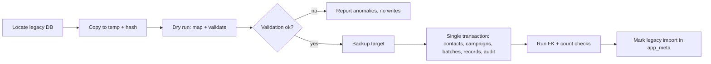

# 07 — Testing, migration and release

## Test strategy

The rewrite moves business rules out of widgets, so most behaviour is testable without a
window. The pyramid:

```text
                 ┌──────────────────────────┐
                 │ Playwright E2E (few)      │  real app or mocked IPC
                 ├──────────────────────────┤
                 │ Svelte component tests   │  Vitest + Testing Library
                 ├──────────────────────────┤
                 │ Rust integration tests   │  real temp SQLite, migration + repo
                 ├──────────────────────────┤
                 │ Rust unit tests (many)   │  domain, reconcile, parsers, validation
                 └──────────────────────────┘
```

### Rust

- **Domain unit tests:** contact email change/history, campaign status transitions,
  audience selection, send-batch creation rules.
- **Reconciliation table tests:** every action (`add`, `update_details`, `update_email`,
  `restore`, `mark_removed`, `noop`, `conflict`) and every matching path (current email,
  historical email, identity key, ambiguity).
- **Parser tests:** xlsx/csv fixtures for header detection, blank rows, trailing totals,
  missing columns, duplicate emails, whitespace/case, and invalid addresses.
- **Store integration tests:** run every migration against a fresh temp file
  (`tempfile::TempDir`), then exercise each repository. Assert `foreign_key_check`.
- **Migration tests:** golden fixtures of legacy databases; assert counts, sampled rows,
  and idempotent refusal on a second run.
- **Command tests:** call the service layer through the same request structs used by
  commands; assert error codes and event emission intentions.
- **Property tests:** optional `proptest` for reconciliation invariants (no duplicate
  live email, no lost contact, plan apply = plan summary).

Commands:

```bash
cargo fmt --all --check
cargo clippy --workspace --all-targets -- -D warnings
cargo test --workspace
cargo test -p weasel-store -- --test-threads=1   # if temp DB contention appears
```

### Frontend

- **Unit:** formatting, fuzzy search, query-key builders, error mapping, feature
  registry ordering/filtering.
- **Component:** contact table states, import wizard steps, campaign audience tabs,
  command palette, dialogs, conflict queue. Mock the generated `commands` module; never
  mock raw `invoke` strings.
- **Contract:** compile against generated bindings; a missing field is a type error.
- **E2E:** Playwright against the app with a seeded temp database, or against the web
  build with a fake IPC adapter. Cover: import → preview → apply; create campaign →
  prepare send; re-copy; roster removal; conflict resolution; keyboard-only flow.
- **Accessibility:** `vitest-axe` or Playwright axe on primary routes; manual
  VoiceOver/NVDA pass before 1.0.

Commands:

```bash
pnpm check          # svelte-check + TypeScript
pnpm lint           # eslint + prettier check
pnpm test           # vitest
pnpm test:e2e       # playwright
pnpm build          # static adapter build
```

### Cross-cutting checks

```bash
pnpm bindings && git diff --exit-code   # generated IPC types are current
cargo test -p weasel-testkit             # fixtures and fake ports compile
```

## CI pipeline

GitHub Actions, triggered on pull requests and tags.

1. **Frontend job:** install with pnpm cache, `pnpm check`, `pnpm lint`, `pnpm test`,
   `pnpm build`.
2. **Rust job:** stable toolchain, `cargo fmt --check`, `cargo clippy -D warnings`,
   `cargo test --workspace`.
3. **Contract job:** run bindings exporter; fail on dirty diff.
4. **Platform build matrix:** macOS (arm64 + x64), Windows x64, Ubuntu 22.04. Cache
   Rust and pnpm; run `tauri build` in debug/unsigned mode for PRs.
5. **Release job (tags only):** signed/notarized macOS build, signed Windows build,
   Linux AppImage/deb, generate updater manifest, attach artifacts to the GitHub release.

Branch protection requires jobs 1–3. Platform builds are required before a release tag.

> **Premise change (2026-11-11):** no legacy data support — see
> [ADR 0006](../adr/0006-clean-rewrite-no-legacy-data.md). The discovery, import and
> validation flow below is historical and will not be implemented.

## Legacy database migration

### Discovery

On first run, the app looks for a legacy DB in this order:

1. path stored in settings (if the user previously chose one);
2. the platform app-data location for the old app, if any;
3. a user-selected file via "Import existing Weasel database".

It never silently overwrites or deletes a legacy file.

### Flow



Rules:

- Import only into an empty application database, or into one explicitly confirmed by
  the user with a target backup. Never merge silently.
- Preserve legacy ids where possible so support can cross-reference.
- Snapshot send-record names/emails at migration time (history cannot be recovered from
  the legacy DB after future edits anyway).
- Record warnings in the audit event: unknown timestamps, orphan send rows, mixed
  campaigns per paste, duplicate emails that `INSERT OR IGNORE` had hidden.
- Refuse to commit if `PRAGMA foreign_key_check` is non-empty or counts differ. The temp
  copy is discarded; the source is untouched.
- Keep the migrated source file; offer "open backup folder" from diagnostics.

### Validation report

The UI shows a pre-commit report:

```text
Legacy database: weasel_lair.db (sha256: …)
Contacts:        1,284 -> 1,284
Campaigns:          27 -> 27
Send batches:       31 -> 31
Send records:    3,912 -> 3,912
Warnings:            2  (2 rows with missing source timestamps)
Foreign keys:       OK
```

Only after the user confirms does the transaction run. A failed import leaves the app
database empty and usable.

## Release engineering

### Versioning

- App version follows semver (`0.x` during rewrite, `1.0.0` at parity).
- IPC `apiVersion` is reported by `app_info`; breaking command changes require a version
  bump and a compatibility plan.
- Database schema version is exposed by `app_health`; migrations are monotonic.
- Updater channels: `beta` during phases 4–7, `stable` from 1.0.

### Packaging

- Bundle identifier: `dev.paraversal.weasel` (confirm before first signed release).
- Product name: `Weasel`.
- Icons generated for all platforms from a single source.
- macOS: hardened runtime, entitlements only for file access needed by dialogs,
  notarization via CI secrets.
- Windows: code signing certificate in CI secrets; NSIS/MSI target.
- Linux: AppImage and `.deb`; document WebKitGTK dependency.
- Bundle the SQLite library statically (`sqlx` bundled SQLite) so no system dependency
  mismatch.

### Updater

- `tauri-plugin-updater` with a signed manifest hosted on GitHub Releases (or a static
  endpoint).
- Check on launch (non-blocking) and from Settings; show release notes; never force an
  update while an import is running.
- Database backup before an update that ships a schema migration.

### Observability and support

- Structured logs with rotation in the app log directory.
- `app_health` and a diagnostics export (versions, schema, counts, log tail, redacted
  settings).
- Email addresses redacted in logs by default.
- Crash dialog points to the log folder and offers a "copy diagnostics" action.

### Rollback

- Keep the previous app version installable; document downgrade.
- Before every schema migration, create `weasel.sqlite3.pre-<version>.bak` and record its
  path in `app_meta`.
- Never write a migration that cannot be applied to a copy of the real database in a
  test. The migration test suite runs the full chain on every PR.
- If a release is bad: unpublish the updater manifest, revert the release tag, publish a
  fixed build. Data rollback is restore-from-backup, not a down-migration, unless a
  specifically tested down-migration exists.
